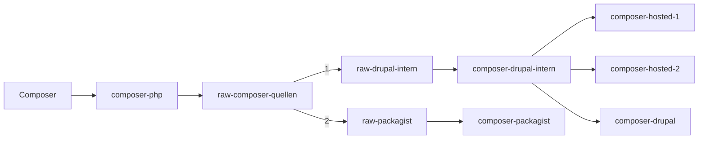

# Drupal, Packagist und eigene PHP-Pakete in Nexus einrichten

Du kannst **eine einzige Composer-URL ausschließlich mit Nexus** bereitstellen. Darüber beziehen Entwicklung und CI Packagist-Pakete, stabile Drupal-Module und Pakete aus zwei Hosted-Repositories. Die Anleitung verwendet die eingebauten Repository-Typen von **Nexus Repository Community Edition 3.96.3-01**. Der Aufbau lief mit **Composer 2.10.2** auch bei deaktiviertem anonymem Zugriff.

## Welchen Aufbau brauche ich?

- Für **eine Composer-URL** führe die Schritte 1 bis 6 durch. Die Adresse für die Teams ist `https://nexus.example.org/repository/composer-php/`.
- Wenn **zwei Nexus-URLs** möglich sind, genügen die ersten fünf Repositories. Springe nach Schritt 2 zur Variante am Ende der Anleitung. [Variante mit zwei URLs](#einfachere-variante-mit-zwei-nexus-urls)

Die Namen sind Beispiele. Vorhandene Hosted-Repositories und einen funktionierenden Packagist-Proxy kannst du übernehmen. Lege die neue Gruppe und den neuen Einstieg zunächst unter eigenen Namen an. So können bestehende Projekte während der Abnahme ihre bisherigen URLs nutzen.

## 1. Routing-Regel für stabile Drupal-Releases anlegen

Öffne als Administrator **Settings → Repository → Routing Rules → Create routing rule**. Gib als Namen `composer-drupal-stable` ein. Wähle **Mode → BLOCK** und füge die folgenden drei Ausdrücke als **drei einzelne Matcher** hinzu. Speichere die Regel. [Sonatype-Dokumentation zu Routing Rules](https://help.sonatype.com/en/routing-rules.html)

```text
^/p2/drupal/[^/?]+~dev\.json(?:\?.*)?$
^/p2/drupal/core\.json(?:\?.*)?$
^/drupal/core/.*$
```

Der erste Matcher filtert Drupal-Dev-Branches aus, für die Nexus ungültige Archivangaben erzeugen kann. Die beiden anderen sperren am Drupal-Proxy die Paketmetadaten und die Archive für `drupal/core`. Dadurch kommt Core von Packagist. Drupal.org liefert an seinem Core-Metadatenpfad ausschließlich Sicherheitsmeldungen. [Drupal-Core-Metadaten](https://packages.drupal.org/files/packages/8/p2/drupal/core.json)

## 2. Die zwei Paketquellen und die eigenen Repositories einrichten

Öffne **Settings → Repository → Repositories → Create repository** und wähle das Rezept aus der Tabelle. In der Nexus-One-Oberfläche findest du **Settings → Repositories → Create Repository** und wählst Format und Typ getrennt. Bei bestehenden Repositories öffnest du den Namen zum Bearbeiten. Wähle den für eure PHP-Pakete vorgesehenen **Blob store** und lasse die Repositories **Online**. [Composer-Repositories in Nexus anlegen](https://help.sonatype.com/en/create-a-composer-repository.html)

| Name | Rezept | Einzutragende Einstellung |
| --- | --- | --- |
| `composer-hosted-1` | `composer (hosted)` | Erstes internes Repository. Für unveränderliche Releases **Deployment policy → Disable redeploy**. |
| `composer-hosted-2` | `composer (hosted)` | Zweites internes Repository. Gleiche Deployment Policy für unveränderliche Releases. |
| `composer-drupal` | `composer (proxy)` | **Remote storage** auf `https://packages.drupal.org/files/packages/8/` setzen. Unter **Routing rule** die Regel `composer-drupal-stable` aus Schritt 1 auswählen. |
| `composer-packagist` | `composer (proxy)` | **Remote storage** auf `https://repo.packagist.org/` setzen. Für diese öffentliche Quelle die Routing-Regel leer lassen. |
| `composer-drupal-intern` | `composer (group)` | Unter **Member repositories** zuerst `composer-hosted-1`, dann `composer-hosted-2`, dann `composer-drupal` auswählen. |

Die Drupal-URL endet bewusst auf **`/files/packages/8/`**. Nexus 3.96.3-01 hängt `p2/` an die Remote-URL an. Unter diesem Pfad findet es die von Drupal veröffentlichten Versionslisten. Der Packagist-Proxy bleibt für Schritt 3 separat. Das verhindert, dass eine native Composer-Gruppe beim Zusammenführen der Packagist-Metadaten einen falschen Archivpfad erzeugt. [Drupal-Repository-Index](https://packages.drupal.org/8/packages.json)

Eigene Pakete lädst du unter **Upload** in das jeweilige Hosted-Repository. Wähle das ZIP mit der `composer.json` des Pakets. Wenn im Archiv die Version fehlt, gib sie beim Upload an. Bereits veröffentlichte Pakete kannst du direkt verwenden. [Sonatype-Anleitung zum Upload](https://help.sonatype.com/en/composer-cli-usage.html)

## 3. Beide Quellen hinter einer einzigen Composer-URL bereitstellen

Lege die vier folgenden Repositories **in Tabellenreihenfolge** an. Die Beispieladresse `http://127.0.0.1:8081` ist der **aus dem Nexus-Prozess erreichbare Nexus-Webserver**. Passe Port und gegebenenfalls Kontextpfad an eure Installation an. Verwende für die drei internen Remote-URLs denselben Host, Port und dasselbe Schema. Die Clients bekommen später die externe HTTPS-Adresse.

Falls Nexus die interne Remote-URL beim Speichern wegen seines SSRF-Schutzes ablehnt, öffne in der Classic UI **Settings → System → API**, in der Nexus-One-Oberfläche **API**. Lies im Bereich **Security Management: SSRF Protection** mit `GET /service/rest/v1/security/ssrf-protection` die aktuellen Einstellungen. Ergänze für den gezeigten Aufbau `127.0.0.1` in `allowedIPs` und sende das vollständige Objekt einschließlich der bisherigen Einträge per `PUT` an denselben Pfad. Der Schutz bleibt aktiviert. Die Ausnahme gilt instanzweit für diese IP. Falls eure Betriebsregeln sie ausschließen, verwende die Zwei-URL-Variante. [Sonatype-API](https://help.sonatype.com/en/api-reference.html) · [Nexus-Absicherung](https://help.sonatype.com/en/securing-nexus-repository-manager.html)

| Name | Rezept | Remote Storage bzw. Mitglieder |
| --- | --- | --- |
| `raw-drupal-intern` | `raw (proxy)` | `http://127.0.0.1:8081/repository/composer-drupal-intern/` |
| `raw-packagist` | `raw (proxy)` | `http://127.0.0.1:8081/repository/composer-packagist/` |
| `raw-composer-quellen` | `raw (group)` | Erst `raw-drupal-intern`, dann `raw-packagist`. |
| **`composer-php`** | **`composer (proxy)`** | `http://127.0.0.1:8081/repository/raw-composer-quellen/` |

Die Raw-Gruppe liefert für jede angefragte Metadatendatei die erste Quelle mit einem Treffer. Dadurch bleiben Packagists Angaben zu den verschiedenen Versionen beim Durchreichen erhalten. Bieten zwei Quellen denselben Paketnamen an, hat die erste Quelle Vorrang für dessen Versionsliste. Der äußere **`composer-php`** erzeugt die Archiv-URLs für die Clients. **Nur seine URL gibst du an die Projektteams weiter.**



Setze für die Abnahme auf **beiden Raw-Proxys** `Maximum component age = 0` und `Maximum metadata age = 0` (Minuten). Paketlisten unter `p2/*.json` sind für ein Raw-Repository gewöhnliche Dateien. Bei einer unbegrenzten Komponenten-Cachezeit könnten neue Releases deshalb unsichtbar bleiben. Der Test verwendete für die Composer-Proxys `Maximum metadata age = 0` und `Maximum component age = -1`. Der negative Cache und die automatische Sperre bei Remote-Fehlern waren für die Test-Proxys ausgeschaltet. **Strict Content Type Validation** war eingeschaltet. Bei einem positiven Raw-Cachealter im Betrieb plane die entsprechende Verzögerung für neue Releases ein. [Nexus-Cache-Einstellungen](https://help.sonatype.com/en/repository-management.html)

## 4. Internen Zugriff und Leserechte setzen

- **Bei deaktiviertem anonymem Lesen** lege unter **Security → Roles / Users** ein technisches Konto an. Gib ihm `browse` und `read` auf den acht inneren Repositories aus Schritt 2 und 3. Trage dieses Konto bei `raw-drupal-intern`, `raw-packagist` und `composer-php` jeweils unter **HTTP Authentication → Username / Password** ein. Die beiden öffentlichen Upstreams in Schritt 2 bleiben ohne Anmeldedaten.
- **Für Entwickler und CI** genügen `browse` und `read` auf **`composer-php`**, beispielsweise `nx-repository-view-composer-composer-php-read` und das entsprechende `-browse`-Privileg. Das Projekt nutzt seine Nexus-Leseanmeldedaten für den öffentlichen Nexus-Host. Das technische Konto bleibt im Repository-Manager.

## 5. Diese Konfiguration an das Projektteam geben

Ersetze `nexus.example.org` durch euren öffentlichen Nexus-Host. Im Abschnitt `repositories` der **Projekt-`composer.json`** genügt ein Nexus-Eintrag. Entferne für die Abnahme vorhandene direkte Drupal- und Packagist-Einträge. `packagist.org: false` schaltet Composers impliziten Zugriff auf das öffentliche Packagist ab.

```json
{
  "repositories": [
    { "type": "composer", "url": "https://nexus.example.org/repository/composer-php/" },
    { "packagist.org": false }
  ]
}
```

## 6. Installation abnehmen

Verwende ein frisches Testprojekt mit der Konfiguration aus Schritt 5 und einem für eure Drupal-Version geeigneten PHP. Führe die Befehle einzeln aus. Ersetze in der letzten Zeile die Beispielnamen durch die tatsächlich hochgeladenen Pakete und Versionen.

```bash
composer --no-cache --no-plugins --no-scripts require --prefer-dist psr/log
composer --no-cache --no-plugins --no-scripts require --prefer-dist drupal/nbsp
composer --no-cache --no-plugins --no-scripts require --prefer-dist beispiel/paket-eins:1.0.0 beispiel/paket-zwei:1.0.0
```

Prüfe anschließend die Archiv-URLs im Lockfile und die tatsächlich verwendete Installationsquelle. Beide Befehle sollen `true` ausgeben. Ein erfolgreicher Abruf von `packages.json` allein würde einen späteren HTTP 404 beim Archivdownload nicht erkennen.

```bash
jq -e --arg repo 'https://nexus.example.org/repository/composer-php/' '
  [(.packages + ."packages-dev")[] | select(.type != "metapackage")] |
  length > 0 and all(.[]; (.dist.url // "") | startswith($repo))
' composer.lock

jq -e '[.packages[] | select(.type != "metapackage")] |
  length > 0 and all(.[]; ."installation-source" == "dist")' vendor/composer/installed.json
```

Hast du vorhandene Proxys umgestellt und erhältst weiter einen früheren HTTP 404, öffne die betroffenen Proxys und Gruppen unter **Repositories** und wähle **Invalidate cache**. Wiederhole die Abnahme mit leerem Composer-Cache. [Nexus-Cache invalidieren](https://help.sonatype.com/en/repository-actions.html)

**Auf 3.96.3-01** installierte Composer `psr/log 3.0.2`, `drupal/nbsp 3.1.3`, Core und Scaffold `11.4.14` sowie beide Hosted-Testpakete. Alle **68 Archive** kamen über dieselbe Composer-URL. Das NBSP-ZIP stimmte mit der Drupal-Prüfsumme überein. In einem gesonderten Test erzeugte das aktivierte Scaffold-Plugin `web/index.php`. Eine neu hochgeladene Hosted-Version war mit den angegebenen Raw-Cachewerten beim ersten erneuten Abruf sichtbar. Auch der Test mit einem auf `composer-php` beschränkten Lesekonto bestand. Die Abnahme auf eurer Instanz steht aus.

## Einfachere Variante mit zwei Nexus-URLs

Wenn zwei Einträge für die Projekte passen, genügen **Schritt 1 und 2**. Gib den Projektkonten `browse` und `read` auf `composer-drupal-intern` und `composer-packagist`. Die Reihenfolge in der Projektdatei ist wichtig.

```json
{
  "repositories": [
    { "type": "composer", "url": "https://nexus.example.org/repository/composer-drupal-intern/" },
    { "type": "composer", "url": "https://nexus.example.org/repository/composer-packagist/" },
    { "packagist.org": false }
  ]
}
```

Dieselben drei Installationsbefehle aus Schritt 6 funktionierten so auf **3.96.3-01 und 3.98.3-01**. Im Lockfile kamen 65 Archive vom Nexus-Packagist-Proxy, NBSP und die beiden eigenen Pakete von der Nexus-Gruppe. Für diese Variante sind beide Nexus-Pfade gültige Archivziele.

## Geltungsbereich

Beide Varianten beziehen **stabile Drupal-Releases**. Die Routing-Regel filtert Drupal-Dev-Branches. Prüft die Abdeckung der Drupal-Sicherheitsmeldungen für `composer audit` separat. Die herkömmliche einzelne `composer (group)` mit einem direkt eingebundenen Packagist-Proxy lieferte im Gegenversuch auf **3.96.3-01 und 3.98.3-01** für Scaffold `11.4.14` einen Archivpfad mit `11.4.9` und beim Download HTTP 404. Für eine Korrektur dieses Gruppenverhaltens ist mit Stand **26. November 2026** kein öffentlicher Liefertermin bestätigt. [Verwandter Sonatype-Fehlerbericht](https://github.com/sonatype/nexus-public/issues/1046) · [Sonatype-Release-Notes](https://help.sonatype.com/en/nexus-repository-2026-release-notes.html)
